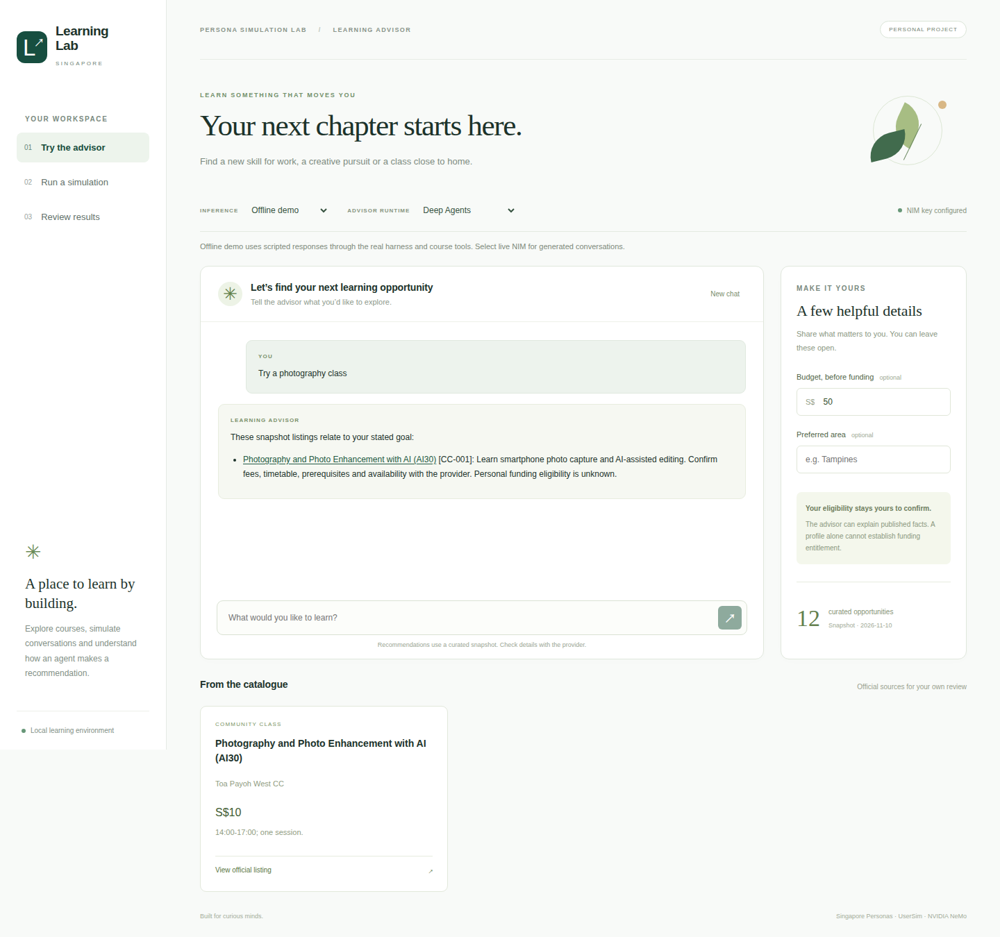

# Singapore Learning & Classes Advisor

A personal learning lab for building and evaluating a course advisor with Singapore Nemotron Personas, UserSim and the NVIDIA NeMo stack. Explore career skills and community classes through a local SvelteKit application.



## Contents

- [Run Locally](#run-locally)
- [Five Learning Phases](#five-learning-phases)
- [Useful Commands](#useful-commands)
- [Data And Results](#data-and-results)
- [Development](#development)

## Run Locally

Requires Python 3.12, uv, Node.js 22.17 or newer within a supported release, and npm. The tested versions are locked.

```bash
uv sync --locked
uv sync --project integrations/helix --locked
uv sync --project integrations/designer --locked
npm --prefix web ci
npm --prefix web run dev
```

Open the local address printed by the server. The app starts in **Offline demo**, which exercises the actual harness and MCP tools with scripted responses. Startup makes no inference calls.

For live inference, create a local `.env` using [.env.example](.env.example). Preserve an existing file. Add `NVIDIA_API_KEY` and select **Live NVIDIA NIM** in the app. The advisor defaults to `nvidia/nemotron-3.5-lightning-30b-a3b`. User, judge and summary roles default to `nvidia/nemotron-3-nano-omni-30b-a3b-reasoning`. Role-specific settings or `NIM_MODEL` can override these defaults.

Before a live persona simulation:

```bash
uv run python scripts/inspect_personas.py --download
```

This downloads the pinned public HF dataset, audits all records and creates a small local coverage panel. The public download is approximately 275 MB. The catalogue has already been curated from official sources; runtime access to those sites is unnecessary.

## Five Learning Phases

1. **Functional advisor:** SvelteKit chat, a curated course snapshot, read-only MCP tools, Deep Agents and hosted UserSim conversations.
2. **Relay:** native framework instrumentation with paired agent, model and tool events.
3. **Fabric:** the maintained Deep Agents adapter, typed planning and a persistent runtime per conversation.
4. **Helix:** local SDK scoring of saved replies and frozen regression cases, plus a locally validated managed-agent configuration.
5. **Data Designer:** a separate enrichment pipeline that adds labelled preference hypotheses, preserves original profiles and supports a paired ablation.

See the [learning guide](docs/learning-guide.md), [architecture](docs/architecture.md), [implementation plan](PLAN.md) and [verification record](docs/verification.md). Repository guidance and coaching are in [AGENTS.md](AGENTS.md) and [.agents/skills/persona-lab-coach](.agents/skills/persona-lab-coach/SKILL.md).

## Useful Commands

```bash
uv run learning-lab doctor
uv run learning-lab chat "Find a photography class" --budget 50
uv run learning-lab chat "Find a photography class" --budget 50 --live --engine relay
uv run learning-lab simulate --live --personas 3 --paired --turns 2
uv run learning-lab benchmark --live
uv run learning-lab enrich
uv run learning-lab ablate --live
```

The interface also provides simulation progress, cancellation, saved conversations and local Helix checks. Each experiment or benchmark has a 120-call cap, including model retries and judges. Provider responses are capped at 1,024 output tokens; conversations have at most three turns. Four tool rounds are allowed per advisor reply. Provider retries are disabled.

## Data And Results

The public HF dataset contains 148,000 synthetic individuals and no OCEAN fields. **HF profile-only** mode explicitly omits personality conditioning. UserSim's loop settings still apply; these are operational defaults, not measured traits. **NGC Extended** mode uses UserSim's documented materialization path and requires a separately configured local dataset. NGC inference access and dataset access are separate. Read [the dataset review](docs/personas.md) before selecting a mode.

Course prices, timetables and intakes are a dated snapshot. The advisor preserves unknowns and asks the learner to confirm personal funding eligibility. It does not book courses or establish entitlement. Automated scores are limited checks of model outputs; they do not predict real people's choices.

Credentials, raw data, generated conversations, traces and evaluation artifacts stay in ignored local directories. Application code is [MIT licensed](LICENSE). Dependencies and datasets retain their own licenses; the public HF dataset requires CC BY 4.0 attribution. See [attribution](NOTICE.md) and [sources and compatibility](docs/sources.md).

## Development

```bash
uv run pytest -q
uv run ruff check src tests scripts integrations
npm --prefix web run check
npm --prefix web test
npm --prefix web run test:e2e
npm --prefix web run build
```

Browser tests need Chromium: `cd web && npx playwright install chromium`. CI installs the isolated SDK environments and runs offline, without API keys or source datasets. Live acceptance checks are explicit: `uv run python scripts/verify_live.py --live`.

For a production build, run `npm --prefix web run build`, then `HOST=127.0.0.1 PORT=4174 node web/build` from the repository root. Keep the Python environment alongside the Node server; its worker starts automatically. Helix Platform registration and deployment are separate from this local lab.
