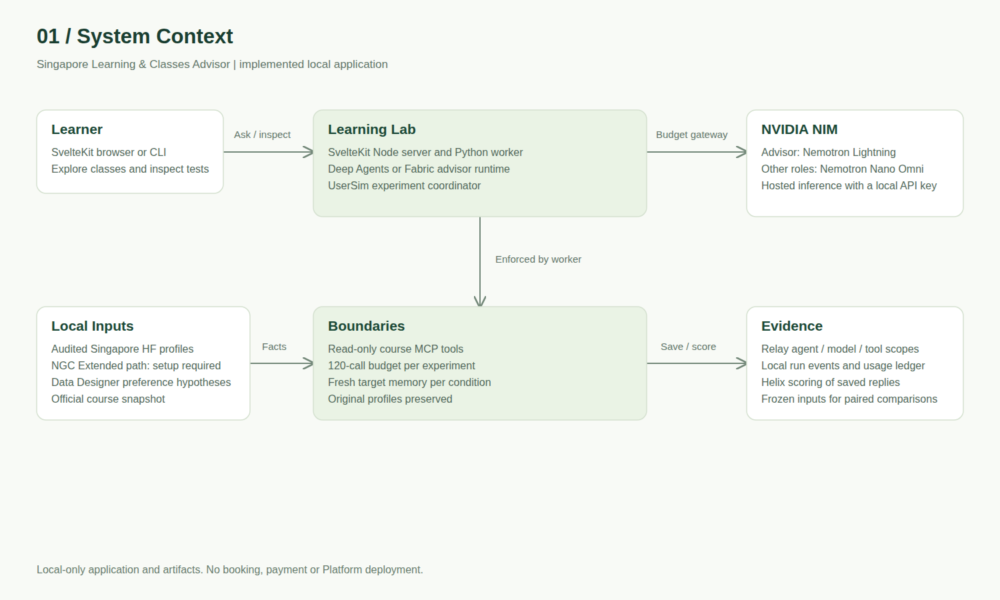
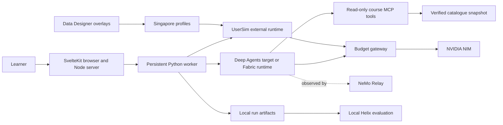
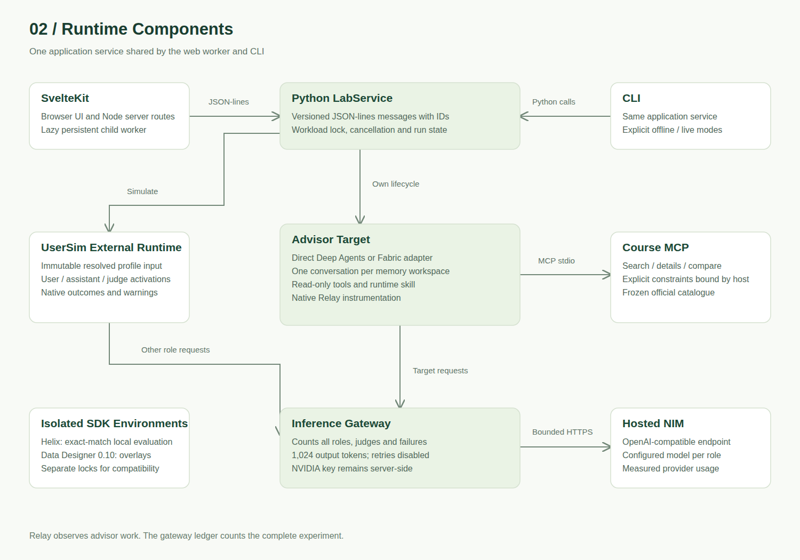
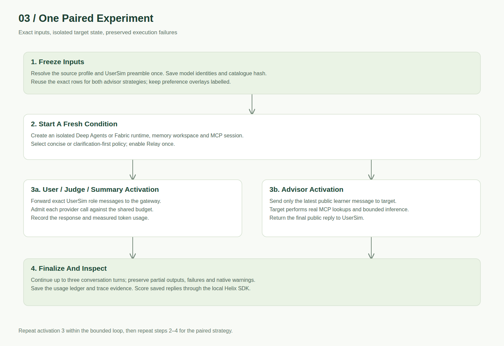
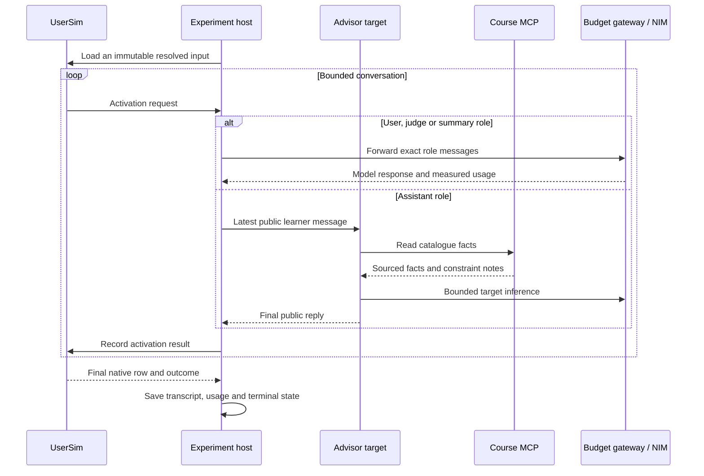

# Application Architecture

## Contents

- [System Context](#system-context)
- [Runtime Design](#runtime-design)
- [Episode Flow](#episode-flow)
- [State And Failure Handling](#state-and-failure-handling)
- [Deployment](#deployment)

## System Context

The learner uses a local SvelteKit application or CLI. NVIDIA NIM supplies inference. Synthetic Singapore profiles drive simulated learners; official catalogue snapshots supply course facts.

## Runtime Design

SvelteKit owns the UI and server API routes. The Node server starts one Python worker lazily and exchanges validated JSON-lines messages with request IDs. Worker stdout is reserved for protocol messages; library output goes to stderr. App startup makes no inference calls.

The Python service owns the experiment ledger, run state and task cancellation. Each target session owns its harness state and MCP connection. A read-only MCP server supplies search, detail and comparison operations. Explicit budget, day and prerequisite constraints are bound outside the model's chosen tool arguments.

The direct target uses Deep Agents with an allowlist that removes built-in shell, delegation and filesystem tools from the model. Fabric uses its maintained adapter and the same three course operations. Both reach NIM through the same loopback gateway, where every call is admitted against a shared run cap. The gateway is the only holder of the real inference key in the target's model transport.

Relay observes the target's model and tool work. The coordinator's event log and gateway usage ledger remain authoritative for the whole experiment, including simulated-user and judge calls. Helix and Data Designer run in separate subprocess environments to preserve supported dependency versions.

## Episode Flow

The host never sends the hidden profile or judge rubric to the target. Real course tools execute only in the target. The UserSim probe offers no duplicate simulated assistant tools. Paired strategies reuse the exact materialized profile rows and receive fresh target state; a sampling seed alone is not a replay guarantee.

## State And Failure Handling

- Source records and overlays remain local. Overlays carry explicit hypothesis labels, source hashes and pipeline versions.
- Target memory persists within one conversation and is fresh for each experimental condition. One retained interactive chat is supported per worker; starting another workload closes it.
- Progress and events are saved incrementally. Cancellation closes resources and retains partial output. An experiment records failed conditions and continues other conditions while its total budget remains available.
- Worker restarts mark runs owned by a dead process as interrupted. A live worker's run is not reclassified by another CLI session.
- A failing provider or native runtime produces a visible failure. Provider retries are disabled; repeated judge activations are still admitted through the gateway.
- Unknown usage remains unknown in app records. UserSim activation counts and actual provider call counts are separate, because one advisor activation can make several model calls.

## Deployment

The baseline is a local Node server, its Python worker and hosted NIM. No GPU, database service or Kubernetes cluster is required. Use `adapter-node` for a persistent server. Bind local previews to loopback.

The managed configuration under `agents/learning-advisor` is schema- and plan-validated with Helix's compatible environment. Platform registration and deployment have not been performed. Its deployment policy needs equivalent inference-budget admission before it can claim the app's run-level budget guarantee.
