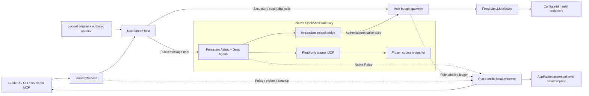

# Application Architecture and Current Delivery Boundary

**Building Citizen Apps with NeMo** is the guide's display name, with the subtitle **NeMo Stack Integration Guide · Singapore**. Repository paths and integration identifiers retain their existing names.

## Current implementation review

The [North Star](project-goals.md) is unchanged: teach the whole citizen application through understandable behaviour, integration code and evidence. The user authorised the [shared foundation and photography gate](../PLAN.md) after the isolated wireframe.

The guide has Why NeMo Stack, Integration Map, Q&A and Datasets in repository `web/`. It uses one curated demo per scenario, with explicit missing/planned states and no latest-run fallback. **Simulate a Session** opens prerequisite-checked photography execution; start is separate from playback. Board games and dream-job learning stay illustrative. Selected scenario/lesson/operation/turn and layout preferences survive reload; the curated recording supplies its actual configuration. Live workload ownership is independent of inspection.

SvelteKit, Svelte Flow and the existing persistent Python worker are retained. A restricted `--guide-only` worker owns `JourneyService` without initializing legacy `LabService` recovery. Metadata/playback reads start no workload. CLI and host-only developer MCP call the same guide service; older APIs remain compatible.

### Read-only dataset connection

The external guide's **Data schema** subtab preserves the audit snapshot and source types, grouped in human reading order. **Explore profiles** issues only GET reads to three local guide routes: `/api/local-datasets`, `/api/persona-options` and `/api/personas`. The guide's server-only `LAB_ROOT` configuration locates [the shared dataset reader](../web/src/lib/server/datasetReader.ts), which permits only catalogue, source-wide facet and bounded-page operations. It reuses the [worker client](../web/src/lib/server/worker.ts) in persistent **`--datasets-only`** mode and the shared [dataset service](../src/learning_lab/datasets.py). This mode never instantiates the execution service, recovers old run state or acquires workload ownership; both RPC/client boundaries reject execution operations. No arbitrary method, path, locale or resource is accepted from the browser.

Facet reads project geography/education columns. Page queries scan the installed corpus with text, age, geography and education filters, returning at most twenty original rows with their source identities and hashes. Original files remain outside Git and the browser bundle. The UI stores only filter/subtab preferences, cancels obsolete reads and labels unavailable sources rather than supplying fixtures. Dataset APIs return `Cache-Control: no-store`. This connection does not expose simulation, generation, inference or deployment operations.

The [v0.2 architecture and diagrams](history/v0.2/docs/architecture.md) describe the archived integrated experience. They remain useful historical context and must not be displayed as the current wireframe architecture.

## Retained backend boundaries

The Python application service is shared by CLI, the host-only developer MCP and the retained web API route. The persistent worker exchanges versioned JSON-lines envelopes. UserSim owns simulation activations; Fabric owns the selected Deep Agents or Hermes runtime lifecycle. Runtime advisor tools remain limited to read-only course search, details and comparison.

Original persona rows, explicit scenarios, generated hypotheses, public conversation, course facts and model output remain separate data. The backend supports corpus inspection/sample/lock, isolated Data Designer preparation, bounded inference, native evidence projection, saved-reply evaluation and explicit Platform operations. Photography connects its approved subset; the other capabilities remain retained backend references. Read the [backend contracts](contracts.md) for exact interfaces.

Relay records native target events; the gateway also accounts for simulator and judge calls. LiteLLM supplies provider transport; Switchyard is an explicit routing variation. Helix is a broader control plane for operations, evaluation, experiments and hardening. Scenario 3 introduces actual Evals scoring and managed deployment/session/job operations; simpler presets use application-owned assertions with no Helix requirement. Behavioural Guardrails checks are introduced in scenario 2 and reused in scenario 3. Their native adapter remains unimplemented. Platform hosting and inference hosting remain independent choices.

## Guide selection and integration

One root-owned context retains scenario, lesson, operation and public turn across navigation and inspection; run/condition/episode identities come from the scenario’s curated immutable pack. `lessonArchitecture.ts` defines both diagram levels, important operations, nine-lesson paths, official architecture references and expected proof. `guide_lessons.py` binds these views to one verified pack and an independently verified companion; planned scenarios never discover private history or another scenario’s logs. Viewing another module starts no inference, resets no episode and changes no workload ownership. Native IDs remain attributable to their owning component; missing cross-component parentage stays explicit. Code/configuration links target allowlisted symbols at the configured GitHub repository’s committed reference; recorded source hashes identify exact matches, changed bytes and uncaptured references. Fixed-recording log links target the matching committed GitHub pack. The teaching panel shows interpreted proof facts rather than source excerpts or raw payload previews; retained artifact APIs remain compatible. Future live-log changes are deferred.

The nine stages are persona selection, situation preparation, building/connecting, execution, investigation, evaluation, routing optimization, behavioural safeguards and controlled deployment. Distinguish preparation edges, request/response edges, evidence edges and deployment control. Designer is not a mandatory hop in each public request; Relay is a side channel. Routing creates a deliberate new condition; saved evidence can be inspected repeatedly.

The initial photography story is one Saturday/S$50 request with known course facts and unknown extras. Board games preserves an honest no-match. The third story introduces private generated context and later public salary/budget disclosures; it must not be treated as implemented by reusing another scenario’s records. See the [walkthrough](learning-guide.md) and [acceptance gates](../PLAN.md).

## Deployment and evidence limits

Photography now contains the application, one persistent Fabric/Deep Agents runtime and course tools in standalone native OpenShell. Each new condition starts fresh memory; public turns share one harness. The allowlisted image contains no personas or credentials, verifies runtime hashes, and receives public context at invocation. Native policy/admission, file/network-denial probes and cleanup are saved separately from the valid course-tool invocation. See [standalone setup](../integrations/openshell/README.md). Board games' Hermes lifecycle and scenario 3's Helix-managed operations remain future gates. Historical fixed-public-preset evidence is not reused to verify these new conditions.

The retained dynamic Docker path has a recorded host-ingress limitation. The pinned external-driver dynamic OpenShell path is not enabled. Preserve the isolated SDK environments, generated Relay configuration/interpreter workarounds and actual limitations in [sources](sources.md). A checked-in intent file does not establish native enforcement.

For new acceptance, inspect the actual effective policy/revision, runtime and invocation identities, allowed/denied operations, answer validity and confirmed cleanup. Keep missing spans, unknown usage, partial runs and failed replies. Current housekeeping and the frozen historical record are separated in [verification](verification.md).

## Integration entry points

- [Shared services](../src/learning_lab/service.py), [developer MCP](../src/learning_lab/developer_mcp.py), [CLI](../src/learning_lab/cli.py), [worker protocol](../src/learning_lab/worker.py) and [retained SvelteKit API route](../web/src/routes/api/[operation]/+server.ts).
- [Guide service](../src/learning_lab/journey.py), [preset registry](../src/learning_lab/guide_scenarios.py), [portable sources](../src/learning_lab/guide_sources.py), [saved-response assertions](../src/learning_lab/journey_checks.py), [native lifecycle](../src/learning_lab/sandbox.py) and [in-sandbox runtime](../src/learning_lab/sandbox_runtime.py).
- [Persona selection](../src/learning_lab/datasets.py), [workbench coordinator](../src/learning_lab/workbench.py) and [native Designer pipeline](../integrations/designer/learning_preferences.py).
- [UserSim loop](../src/learning_lab/simulation.py), [probe adapter](../src/learning_lab/probe.py), [Deep Agents target](../src/learning_lab/target.py) and [Fabric/Hermes target](../src/learning_lab/fabric_target.py).
- [Course MCP](../src/learning_lab/course_mcp.py), [budget gateway](../src/learning_lab/inference.py), [LiteLLM configuration](../integrations/proxy/litellm.yaml) and [Switchyard plugin](../integrations/proxy/lab_routing.py).
- [Evidence projection](../src/learning_lab/evidence.py), [answer validity](../src/learning_lab/outcomes.py), [assertions](../src/learning_lab/evaluation.py) and [local Helix SDK scoring](../integrations/helix/evaluate.py).
- [Runtime profiles](../src/learning_lab/runtime_profiles.py), [Platform bridge](../src/learning_lab/deployment.py), [native SDK operations](../integrations/platform/bridge.py), [package construction](../integrations/platform/package_agent.py) and [OpenShell policy intent](../integrations/platform/openshell-policy.yaml).

These are current source entry points. Historical source bytes and documentation remain in the [v0.2 snapshot](history/v0.2/INDEX.md); static excerpts from either tree do not establish a new successful execution.

## Output retention

Superseded run output and runtime artifacts are in ignored, manifest-verified private history. Active or unresolved owner records remain in place. [Housekeeping and recovery](output-housekeeping.md) preserves historical provenance without enabling application execution or changing the public source archives.
