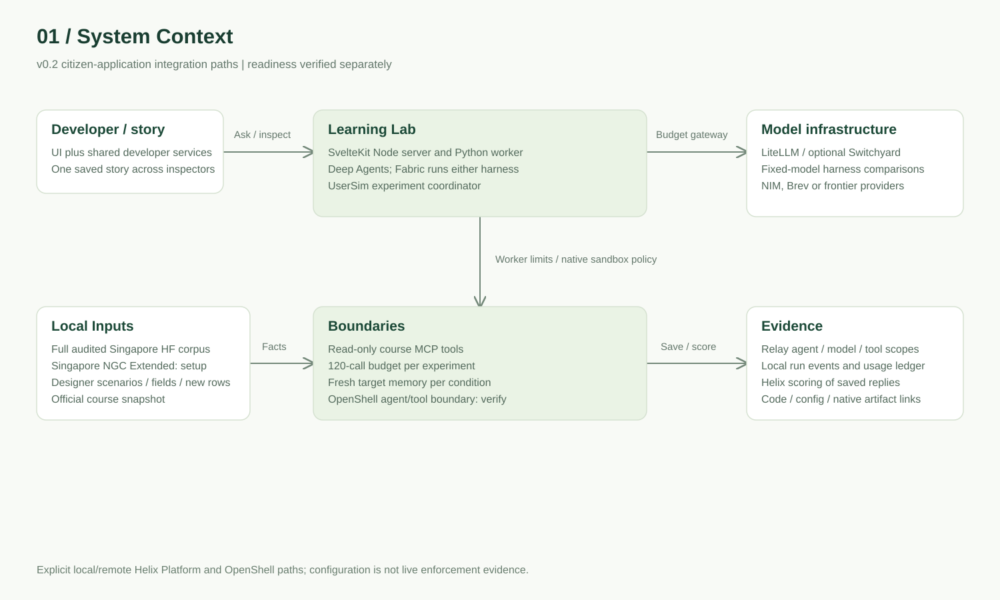
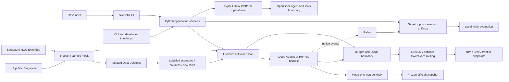
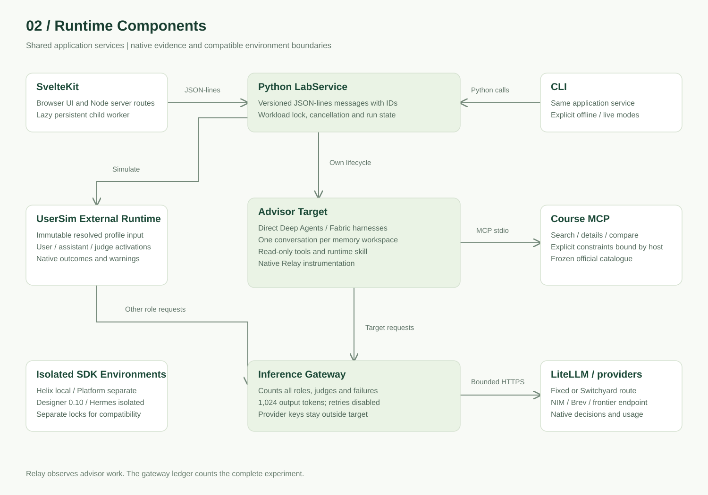
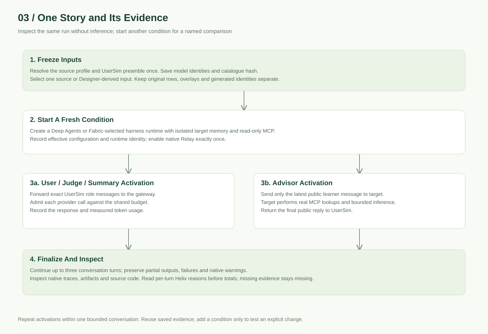

# Application Architecture

## System context

The [North Star](project-goals.md) is an integration lesson around one citizen story. SvelteKit owns the browser and server routes; a persistent Python worker owns shared application services. Original Singapore profiles and dated course facts remain separate from generated scenarios and outputs.

This diagram describes integration paths, not a claim that every external service is currently running. The [verification record](verification.md) is authoritative for actual offline, recorded/live and environment-blocked evidence.

## Runtime boundaries

The Node server starts the Python worker lazily and exchanges strict version-1 JSON-lines messages with request IDs. Stdout is protocol-only. Startup, browsing and saved-evidence inspection make no inference calls. Application services enforce a single active model workload, incremental run state and cancellation.

UserSim owns simulated-user/assistant/judge/summary activations and its native outcome. The application answers each activation through the budgeted model path or advisor target. Hidden profiles and judge instructions stay out of target messages. Target memory lasts within an episode/session; a new condition receives fresh memory and workspace.

The direct Deep Agents target exposes only search, course details and comparison. Fabric owns typed planning and runtime lifecycle for its selected maintained harness adapter. Hermes has a separately installed compatible interpreter/descriptor; selecting it does not silently substitute another harness. The coordinator continues to own experiment conditions and total budgets.

Relay records native harness/model/tool events; the coordinator and gateway also record simulator roles and measured usage. Normalised evidence retains native identifiers and missing/unpaired spans. Fabric configuration/plan/doctor/lifecycle files explain what the runtime actually did. The source inspector distinguishes current local code from the revision stored with a saved run.

## Data and inference flow

The explorer reads the full local parquet source with bounded pages and filters. Sampling records a seed and exact selected rows; locking saves original hashes. A seed is useful provenance, while the frozen resolved input is the replay guarantee. HF public has no OCEAN conditioning. Singapore NGC Extended has separate source/access/readiness requirements.

The Data Designer workbench runs in its isolated 0.10 environment. Closed native structured-column configurations generate source-seeded scenarios, typed added fields or new app-ready profiles. New profiles receive generated identities and parent lineage. Originals are immutable. A per-job loopback bridge forwards generation to the shared gateway with a Designer role and terminal failure semantics; no provider key enters the subprocess. Actual calls count against the job budget.

Saved generation jobs expose their admitted-call ledger directly in the workbench. A saved simulation episode can separately prepare a managed condition: the UI carries public input and original preferences, while the shared service resolves and validates its source reference before any SDK mutation. The new managed conversation has fresh memory and independently packaged facts; incompatible frozen sandbox preferences remain an explicit boundary.

The gateway admits attempts before provider dispatch, caps output, tracks usage/status and preserves unknown cost. The proxy profile can serve a fixed model for harness comparisons or route an explicit Switchyard experiment. Routing evidence must come from the actual plugin/provider interaction; local fallback heuristics do not stand in for native routing.

Fabric 0.6.1's Deep Agents adapter enforces the global catalogue allowlist at execution, while the pinned harness still includes eight built-in filesystem/subagent schemas beside the three catalogue schemas. The application Gateway also filters assistant-role provider requests to the catalogue names for local Fabric Deep Agents chat/simulation and managed Deep Agents sessions. The managed-session harness comes from its deployment snapshot. Hermes keeps its maintained catalogue discovery protocol. This uses the shared application boundary without patching the installed adapter.

The usage ledger records received, exposed and withheld tool-schema names. Native Relay retains the adapter-side request before this filter; its eleven schemas and the ledger's three exposed schemas are observations at different boundaries. Tool/round limits, raw model answers and answer-validity failures remain independently inspectable.

Local Helix receives applicable deterministic assertion rows tied to saved episodes, turns and frozen facts. Answer validity and missing evidence are visible separately. Platform registration/deployment/session operations use a separate compatible SDK bridge; they do not change how the inference provider is hosted.

## Deployment and failures

Helix Platform has local-reference and existing-remote connection profiles. The deployment inference bridge requires an active workload lease and uses the same run gateway before forwarding model requests. A managed agent gets the local admission credential, not provider keys. Remote Platform connections must use validated endpoints and their own local authentication configuration.

OpenShell is the intended agent-and-course-tool execution boundary. The checked-in intent document is not itself an executable/enforced policy; the versioned executor must create the actual policy. Verify permitted MCP/Platform traffic, denied unrelated egress and denied filesystem escape with native evidence. A readiness flag only reports preparation until those checks execute.

The native OpenShell demonstration packages a public, frozen Saturday-photography preset with its hash and the read-only catalogue. Its tools read those explicit constraints inside the image; it does not fetch per-session private preferences through an external credential driver. The agent reaches Helix's Inference Gateway through the executor's native Platform egress rule. The separate Docker environment delivers authenticated per-session preferences. A dynamic OpenShell callback remains blocked by the [external-driver compatibility limit](sources.md#compatibility-workarounds).

Failures remain data: missing answers, malformed pseudo-tool output, provider errors, tool/turn budgets, UserSim findings, cancellation and incomplete pairs are preserved. Do not manufacture a final answer or complete trace. Old runs remain readable with explicit missing-evidence labels and their historical source snapshot; never substitute current catalogue facts.

## Integration entry points

- [Shared application services](../src/learning_lab/service.py), [developer-control MCP](../src/learning_lab/developer_mcp.py), [CLI](../src/learning_lab/cli.py), [worker protocol](../src/learning_lab/worker.py) and [SvelteKit route boundary](../web/src/routes/api/[operation]/+server.ts).
- [Persona explorer and locking](../src/learning_lab/datasets.py), [workbench coordinator](../src/learning_lab/workbench.py) and [native Data Designer pipeline](../integrations/designer/learning_preferences.py).
- [UserSim activation loop](../src/learning_lab/simulation.py), [probe](../src/learning_lab/probe.py), [Deep Agents target](../src/learning_lab/target.py) and [Fabric/Hermes target](../src/learning_lab/fabric_target.py).
- [Course MCP](../src/learning_lab/course_mcp.py), [budget gateway](../src/learning_lab/inference.py), [LiteLLM config](../integrations/proxy/litellm.yaml) and [Switchyard plugin](../integrations/proxy/lab_routing.py).
- [Evidence projection](../src/learning_lab/evidence.py), [answer validity](../src/learning_lab/outcomes.py), [evaluation criteria](../src/learning_lab/evaluation.py) and [Helix SDK execution](../integrations/helix/evaluate.py).
- [Runtime readiness](../src/learning_lab/runtime_profiles.py), [Platform bridge](../src/learning_lab/deployment.py), [SDK subprocess](../integrations/platform/bridge.py) and [OpenShell boundary intent](../integrations/platform/openshell-policy.yaml).

The in-app source index uses an allowlist of these integration entry points. It returns local paths, symbols, excerpts and commit references without exposing arbitrary host files.
